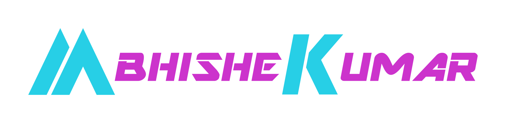

### Lead Android Engineer · Noida, India

I lead Android architecture for enterprise apps that can't afford to crash: 
logistics, healthcare and automotive, at global scale.

---

### At a glance

| **10 yrs** | **3.6s → 1.6s** | **−28%** | **99.5%+** | **5** |
|:---:|:---:|:---:|:---:|:---:|
| Android, one platform | Cold start after Compose migration | UI jank, Perfetto-profiled | Crash-free users, sustained | Android engineers mentored |

**Now:** IT Analyst & Lead Android Developer at **Tata Consultancy Services**, owning mobile architecture and Android delivery for PostNord, Horizon Blue and Tata Motors. 
**Open to:** Senior, Staff and Principal Android roles · India, UK, Europe or remote.

### How I work

- **Architecture.** MVVM and Clean Architecture standards across multi-module codebases. Domain stays pure Kotlin, and module boundaries follow the work.
- **Performance.** Perfetto traces are a release gate. Large-scale Jetpack Compose adoption took cold start from 3.6s to 1.6s and cut UI jank by 28%.
- **Delivery.** GitHub Actions pipelines with tests, detekt and ktlint gates. Regression defects dropped 25% after the gates went in.
- **Accessibility.** WCAG 2.0 certified for mobile and tested with TalkBack. On PostNord, accessibility went from about 10% to about 90%.
- **Leadership.** Five Android engineers mentored; pull-request turnaround down 30%. Primary technical contact for product, backend and QA.

### Featured work

| Project | What it shows |
|---|---|
| [**AF-Bookings**](https://github.com/logtoabhikr/AF-Bookings-Case) · [case study](https://www.abhikr.com/af-bookings-case-study.html) | Open-source itinerary app: Kotlin 2.3, Compose Material 3, Hilt, Flow. Sealed segment models in a pure-Kotlin domain, three Gradle modules, custom-drawn timeline. |
| [**WeatherApp**](https://github.com/logtoabhikr/WeatherApp-Android-Multi-Module-Clean-Architecture-Compose-Kotlin-Hilt-Flow-Retrofit-Coil-Unit-Test) | Multi-module Clean Architecture reference with Compose, Hilt, Flow, Retrofit, Coil and unit tests. |
| [Compose at scale](https://www.abhikr.com/compose-migration-case-study.html) | Enterprise Compose migration without a performance regression (PostNord, Tata Motors). |
| [PostNord Track & Send](https://www.abhikr.com/postnord-case-study.html) | Accessibility at scale, delivered three months on-site in Sweden. |
| [Air France Flying Blue+](https://www.abhikr.com/air-france-case-study.html) | Delivery on a live loyalty app: MVVM over Compose and XML, Kotlin Multiplatform logic. |

Client work is under NDA, so the case studies lead with the constraint, the decision and the result. [All shipped projects →](https://www.abhikr.com/projects.html)

### Tech stack

- **Android:** Kotlin, Jetpack Compose, XML views, Wear OS, Coroutines, Flow, Hilt, Room, WorkManager, Retrofit, OkHttp, Paging 3, Navigation
- **Architecture:** Clean Architecture, MVVM, MVI/UDF, modularization, SOLID, Kotlin Multiplatform
- **Quality:** JUnit, Mockito, Espresso, Perfetto, baseline profiles, Firebase Crashlytics, detekt, ktlint
- **Security:** SSL pinning, R8/ProGuard, root detection, OWASP awareness
- **Cross-platform & AI:** Flutter, Dart, generative AI tooling in the delivery workflow

### Certifications & recognition

- **Claude Certified Developer - Foundations** · Anthropic, 2026 · [verify on Credly](https://www.credly.com/badges/2f924b01-ab8a-40fc-b513-c6aba5da44d2)
- **WCAG 2.0 Accessibility for Mobile Apps** · TCS, 2026
- **Generative AI & AI Fundamentals** · LinkedIn, TCS, 2025
- **Hackathon Winner & Service Award** · Tata Consultancy Services, 2025
- **Arctic Code Vault Contributor** · GitHub, 2020

### Writing

- [Making complex mobile experiences feel simple](https://www.linkedin.com/pulse/lets-talk-making-complex-mobile-experiences-feel-simple-kumar-x72fc) · LinkedIn, April 2026

---

**Let's build something that holds up.** [logtoabhikr@gmail.com](mailto:logtoabhikr@gmail.com) · [www.abhikr.com](https://www.abhikr.com/)

Also on [X](https://x.com/logtoabhikr) · [YouTube](https://youtube.com/@logtoabhikr) · [Instagram](https://instagram.com/logtoabhikr) · [Facebook](https://facebook.com/logtoabhikr)

